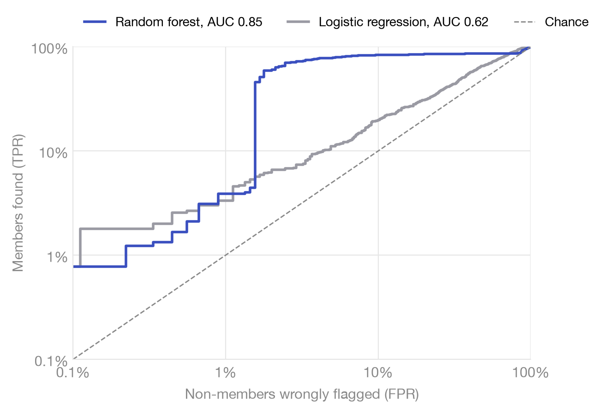

# trainleak

**Does your model leak its training data?**

[](https://github.com/nancypatel12/trainleak/actions/workflows/ci.yml)
[](LICENSE)


`trainleak` attacks your trained classifier the way an adversary would and tells you how well they can spot *who was in your training set*. Accuracy metrics don't measure this.

```python
from trainleak import audit

report = audit(model, X_train, y_train, X_test, y_test)
print(report.summary())
```

```
trainleak audit: RandomForestClassifier
  members / non-members : 898 / 898
  train acc / test acc  : 1.000 / 0.973  (gap +0.027)

  attack                AUC    adv  TPR@0.1%   TPR@1%  TPR@10%
  loss                0.798  0.459     0.000    0.000    0.315
  confidence          0.798  0.459     0.000    0.000    0.315
  entropy             0.797  0.463     0.000    0.000    0.352
  modified_entropy    0.797  0.459     0.000    0.000    0.357
  lira                0.849  0.753     0.008    0.039    0.833

  risk: SEVERE  (strongest attack: lira)
  The model is memorizing its training set. Do not release it if the training data is sensitive.
```

## Why

Two models, same data, same train/test gap (2.7% vs 2.8%). One leaks far more:



LiRA on the digits dataset. The further a curve rises above the dashed line, the more the model leaks. The gap does not predict leakage. Only an attack does.

- **One call.** Any scikit-learn classifier out of the box; PyTorch, JAX, XGBoost or anything else with a few lines.
- **Strong attacks.** [LiRA](https://arxiv.org/abs/2112.03570) (Carlini et al., 2022), plus loss, confidence, entropy and modified entropy.
- **Light.** NumPy, SciPy, scikit-learn. CPU only. A full audit takes seconds.
- **Shareable.** Terminal summary, JSON for CI, standalone HTML report.

## Install

```bash
pip install git+https://github.com/nancypatel12/trainleak
pip install "trainleak[plot] @ git+https://github.com/nancypatel12/trainleak"   # HTML reports
```

No code needed to try it:

```bash
trainleak demo --html report.html
```

## Usage

### scikit-learn

```python
from sklearn.ensemble import GradientBoostingClassifier
from trainleak import audit

model = GradientBoostingClassifier().fit(X_train, y_train)
report = audit(model, X_train, y_train, X_test, y_test)

report.risk                     # "low" | "moderate" | "high" | "severe"
report.strongest.tpr_at[0.01]   # TPR at 1% FPR, strongest attack
report.most_vulnerable(10)      # the 10 most exposed training rows
report.to_html("audit.html")
report.to_json("audit.json")
```

### PyTorch, or any framework

Wrap your model in `fit` and `predict_proba`. LiRA uses `model_factory` to train fresh copies; omit it to run only the fast attacks.

```python
import torch
from torch import nn
from trainleak import audit

class Net:
    def __init__(self, d, k):
        self.net = nn.Sequential(nn.Linear(d, 64), nn.ReLU(), nn.Linear(64, k))

    def fit(self, X, y, epochs=200):
        X, y = torch.as_tensor(X, dtype=torch.float32), torch.as_tensor(y, dtype=torch.long)
        opt = torch.optim.Adam(self.net.parameters(), lr=1e-2)
        for _ in range(epochs):
            opt.zero_grad()
            nn.functional.cross_entropy(self.net(X), y).backward()
            opt.step()
        return self

    def predict_proba(self, X):
        with torch.no_grad():
            return self.net(torch.as_tensor(X, dtype=torch.float32)).softmax(-1).numpy()

make = lambda: Net(X_train.shape[1], 10)   # labels must be 0..k-1
model = make().fit(X_train, y_train)
report = audit(model, X_train, y_train, X_test, y_test, model_factory=make, n_reference=8)
```

Already have a trained network you can't wrap? Pass `predict_proba=lambda model, X: ...` instead.

### Gate releases in CI

```python
report = audit(model, X_train, y_train, X_test, y_test)
assert report.risk in ("low", "moderate"), report.summary()
```

## Results

Strongest of five attacks, 16 LiRA reference models, 50/50 splits, one seed. Reproduce with `python benchmarks/run_benchmarks.py` (2 minutes on an M3 Pro CPU). Numbers: [`benchmarks/results.json`](benchmarks/results.json).

| dataset | model | test acc | train-test gap | best attack | AUC | TPR@0.1%FPR | TPR@1%FPR | risk |
|---|---|---|---|---|---|---|---|---|
| digits | LogReg (C=0.05) | 0.952 | +0.028 | lira | 0.615 | 0.008 | 0.033 | **moderate** |
| digits | RandomForest | 0.973 | +0.027 | lira | 0.849 | 0.008 | 0.039 | **severe** |
| digits | GradBoost | 0.949 | +0.051 | lira | 0.796 | 0.079 | 0.186 | **high** |
| digits | MLP (no reg.) | 0.973 | +0.027 | lira | 0.657 | 0.047 | 0.081 | **high** |
| digits | MLP (L2 + early stop) | 0.937 | +0.040 | lira | 0.538 | 0.000 | 0.016 | **low** |
| breast_cancer | LogReg (C=0.05) | 0.968 | +0.011 | entropy | 0.514 | 0.004 | 0.021 | **moderate** |
| breast_cancer | RandomForest | 0.947 | +0.053 | lira | 0.662 | 0.004 | 0.035 | **high** |
| breast_cancer | GradBoost | 0.947 | +0.053 | lira | 0.621 | 0.014 | 0.081 | **high** |
| breast_cancer | MLP (no reg.) | 0.982 | +0.018 | lira | 0.567 | 0.014 | 0.025 | **moderate** |
| breast_cancer | MLP (L2 + early stop) | 0.933 | +0.007 | lira | 0.515 | 0.007 | 0.018 | **low** |
| synthetic-4class | LogReg (C=0.05) | 0.653 | +0.010 | lira | 0.545 | 0.009 | 0.019 | **low** |
| synthetic-4class | RandomForest | 0.729 | +0.271 | lira | 1.000 | 0.971 | 0.989 | **severe** |
| synthetic-4class | GradBoost | 0.739 | +0.206 | lira | 0.852 | 0.088 | 0.237 | **severe** |
| synthetic-4class | MLP (no reg.) | 0.686 | +0.314 | lira | 0.897 | 0.110 | 0.391 | **severe** |
| synthetic-4class | MLP (L2 + early stop) | 0.685 | +0.187 | lira | 0.753 | 0.058 | 0.145 | **high** |

1. **LiRA wins almost everywhere.** At 1% FPR it finds at least 10× more members than the loss attack in 9 of 15 cases; in 3, the loss attack finds none. Threshold-only audits underestimate risk.
2. **Regularization is a privacy control.** L2 and early stopping take the digits MLP from *high* to *low* for 3.6 points of accuracy.
3. **Mediocre models can still leak everything.** The synthetic random forest scores 73% test accuracy, yet LiRA finds 97% of its training points at 0.1% FPR.

> breast_cancer has only 284 members, so TPR@0.1% is noisy (0.004 is one example). Read TPR@1% there.

## How it works

| attack | idea | cost |
|---|---|---|
| `loss` | Members have lower loss (Yeom et al., 2018) | free |
| `confidence` | Members get higher confidence on their true label | free |
| `entropy` | Members get sharper predictions; needs no labels | free |
| `modified_entropy` | Entropy that penalizes confident *wrong* predictions (Song & Mittal, 2021) | free |
| `lira` | Train *N* reference models on random halves, fit per-example Gaussians to logit-scaled confidence IN vs OUT, score by likelihood ratio (Carlini et al., 2022) | *N* fits |

The audit set is balanced, so chance is exactly AUC 0.5. Risk is the worst grade any attack earns: **severe** at AUC ≥ 0.80 or TPR@1%FPR ≥ 20%, **high** at 0.65 / 5%, **moderate** at 0.55 / 2%, else **low**. Conservative heuristics, not guarantees.

## Decisions

- **TPR at low FPR, not just AUC.** Confidently exposing 1% of your users is a leak, even at AUC 0.51 (Carlini et al., 2022).
- **A balanced audit set.** Equal members and non-members, so chance is exactly AUC 0.5 and advantage means something.
- **Online LiRA with one global variance.** With 16 reference models, per-example variances are noisy; the paper recommends a fixed variance in that regime.
- **The worst attack sets the risk.** One attack that works is enough to leak.
- **No deep learning dependency.** PyTorch, JAX and others plug in through `predict_proba` and `model_factory`, so the core stays NumPy, SciPy and scikit-learn.

## Limits

- A low score means these attacks failed, not that the model is private. Only differential privacy gives worst-case guarantees.
- LiRA's reference models train on half the audit pool (up to 2,000 rows by default), not your full training set. On large datasets, raise `max_samples` so they behave more like your model.
- LiRA retrains your model `n_reference` times. Cheap for classical ML; for large networks, lower it or skip it.
- Benchmarks use one seed, so small differences may be noise.
- Classifiers only, for now. Regression and generative models are on the roadmap.

## Contributing

Good first issues: label-only attacks, XGBoost/LightGBM, regression audits, a `pytest` plugin, a Hugging Face adapter. See the [issues](https://github.com/nancypatel12/trainleak/issues) and [CONTRIBUTING.md](CONTRIBUTING.md).

## Citation

Cite the attack papers above, and optionally:

```bibtex
@software{patel_trainleak_2026,
  author = {Patel, Nancy},
  title  = {trainleak: membership inference audits for machine learning models},
  year   = {2026},
  url    = {https://github.com/nancypatel12/trainleak}
}
```

## License

MIT
